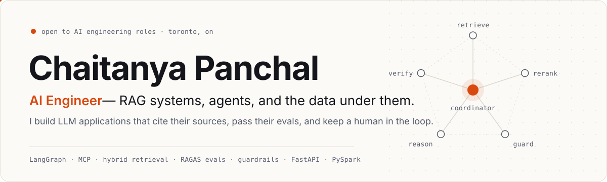
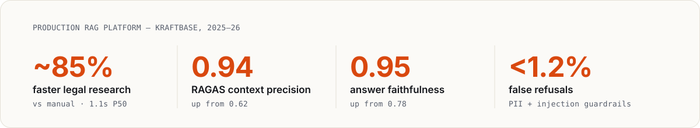
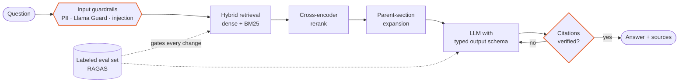

<picture>
  <source media="(prefers-color-scheme: dark)" srcset="./assets/banner-dark.svg">
  
</picture>

  <a href="mailto:panchalchait03@gmail.com"><b>Email</b></a> &nbsp;·&nbsp;
  <a href="https://linkedin.com/in/chaitanyap310"><b>LinkedIn</b></a> &nbsp;·&nbsp;
  <a href="https://chaitanya-0310.github.io/"><b>Blog</b></a> &nbsp;·&nbsp;
  <a href="#-selected-work"><b>Work</b></a> &nbsp;·&nbsp;
  <a href="#-experience"><b>Experience</b></a>

I'm an AI engineer who started as a data engineer, and it shows in how I build: retrieval is a data problem, agents need typed contracts, and nothing ships without an eval that can fail. Most recently I built a production RAG platform for legal research at **Kraftbase**. Before that, I built AWS pipelines on the same team.

<picture>
  <source media="(prefers-color-scheme: dark)" srcset="./assets/impact-dark.svg">
  
</picture>

 

## ◆ Selected work

<table>
<tr>
<td width="50%" valign="top">

### [PROOF](https://github.com/Chaitanya-0310/PROOF)
**Agentic operations copilot for manufacturing.** When a bakery line goes down, it finds the customer orders at risk and the dough that will expire, then drafts the fix for a human to approve.

`recall@5 75.0% → 87.5%` &nbsp; `MRR 0.460 → 0.658`

Coordinator + 5 sub-agents · 29 tools on 5 MCP servers · Python · FastAPI · pgvector · Claude API

</td>
<td width="50%" valign="top">

### [TrustForge](https://github.com/Chaitanya-0310/TrustForge)
**Security questionnaires, answered from evidence.** Every claim is bound to a quoted span in a real document, an independent verifier tries to break it, and it abstains rather than guess.

`phases P0–P1 of 5 done` &nbsp; `30 offline tests`

Multi-agent · triage → retrieve → draft → verify · cost ledger · Python

</td>
</tr>
<tr>
<td width="50%" valign="top">

### [Multi-Agent Marketing Orchestrator](https://github.com/Chaitanya-0310/Multi_Model_AI_Agent)
**A two-week, five-person campaign workflow in about 20 minutes.** Agents plan, draft, and review against brand and compliance rules, and a human approves at each gate.

`14-node StateGraph` &nbsp; `4 HITL interrupts`

LangGraph · ChromaDB RAG · Langfuse tracing · Guardrails AI · Streamlit

</td>
<td width="50%" valign="top">

### [Yukon Population Health Analytics](https://github.com/Chaitanya-0310/Yukon_Data_Analytics)
**Federal health data → a public-health dashboard.** Data from CIHI, PHAC, and StatCan, with outbreak detection and Holt-Winters forecasts. [Live demo ↗](https://yukon-health-dataanalytics.streamlit.app/)

`17 dbt models` &nbsp; `78 tests` &nbsp; `53+ KPIs`

dbt · PostgreSQL/Supabase · Streamlit · Plotly · statsmodels

</td>
</tr>
<tr>
<td width="50%" valign="top">

### [AWS Data Engineering Platform](https://github.com/Chaitanya-0310/AWS-Data-Architecture)
**A full event-driven AWS lakehouse that runs locally.** Ingestion, a Bronze/Silver/Gold medallion on S3, Step Functions, and observability, all on an emulator, with no AWS account needed.

`one-command start` &nbsp; `infra as code`

AWS CDK · Kinesis · Lambda · Airflow · DynamoDB · Docker

</td>
<td width="50%" valign="top">

### [Retail Demand Forecasting](https://github.com/Chaitanya-0310/retail-demand-forecasting)
**How much will we sell, and what does a promo do to margin?** SKU × region forecasts, price elasticity, and a promo what-if simulator, all validated against a known ground truth.

`SARIMAX` &nbsp; `log-log OLS + XGBoost/SHAP`

Python · statsmodels · XGBoost · Streamlit

</td>
</tr>
</table>

<b>In the lab</b>: early-stage builds

 

| Project | What it is |
| --- | --- |
| [FinSentry](https://github.com/Chaitanya-0310/FinSentry) | Synthetic-data financial-crime MVP: replayed transactions, quarantine, explainable AML rules, auditable cases. Kafka · PostgreSQL · NetworkX |
| [AtlasIQ](https://github.com/Chaitanya-0310/AtlasIQ) | Evidence-grounded document intelligence for Canadian public-health reports. FastAPI · MinIO · n8n |
| [StockRAG](https://github.com/Chaitanya-0310/StockRAG-AI-Assistant) | RAG financial assistant with LSTM / Prophet / XGBoost forecasts and an idempotent ETL. pgvector · FastAPI |
| [taskmaster-api](https://github.com/Chaitanya-0310/taskmaster-api) | FastAPI service shipped with Docker, Kubernetes manifests, and GitHub Actions CI. |

## ◆ How I build a RAG system

The retrieval and safety path behind the production numbers above.

## ◆ Experience

**AI/Data Engineer** · Freelance &nbsp;Apr 2025 – current · Remote
 End-to-end legal-research RAG platform (LangChain, GPT-4o, Milvus, PostgreSQL) with cited answers. Parent-child hybrid retrieval and reranking, version-aware clause mapping for multi-year amendments, PII and prompt-injection guardrails under 45 ms added P90, Pydantic structured outputs, and context pruning that cut tokens 42%.

**Data Engineer** · Kraftbase &nbsp;Jan 2023 – Dec 2023 · Vadodara
 Event-driven Lambda validation that cut manual data intervention 50%. Metadata-driven Airflow (MWAA) DAGs shipped through GitHub Actions. Kimball redesign with partitioned Parquet: Redshift 35% faster and 60% cheaper. Idempotent SCD2 across 4+ sources.

**Data Analyst Intern** · Kintu Designs &nbsp;Jun 2022 – Dec 2022 · Gujarat
 Reverse-engineered legacy datasets to find recurring quality issues. Built Power BI KPI dashboards for operations managers.

## ◆ Toolbox

| | |
| --- | --- |
| **AI & LLM** | LangGraph · LangChain · MCP · RAG · RAGAS evals · Milvus · pgvector · ChromaDB · Guardrails AI · Llama Guard · Langfuse |
| **Application** | Python · FastAPI · Pydantic · pytest · SQL · Bash |
| **Data** | PySpark · Glue · dbt · Airflow · Redshift · Databricks · Kimball modeling · SCD2 · medallion |
| **Platform** | AWS · Azure · Docker · Kubernetes · Terraform · GitHub Actions |
| **Automation** | n8n · Zapier · Make · LangFlow |

<picture>
  <source media="(prefers-color-scheme: dark)" srcset="https://skillicons.dev/icons?i=py%2Cfastapi%2Cpostgres%2Credis%2Cdocker%2Ckubernetes%2Caws%2Cazure%2Cterraform%2Cgithubactions&theme=dark&perline=10">
  
</picture>

## ◆ Background

**M.A.C., Applied Computing**, University of Windsor · 2025 &nbsp;&nbsp;|&nbsp;&nbsp; **B.Tech, Computer Science & Engineering**, CHARUSAT · 2023

Certifications: dbt Fundamentals · Databricks Lakehouse Fundamentals · Databricks Generative AI Fundamentals · Snowflake Hands-on Essentials: Data Warehousing · Apache Airflow Fundamentals · Microsoft Fabric End-to-End Analytics

 

<picture>
  <source media="(prefers-color-scheme: dark)" srcset="https://raw.githubusercontent.com/Chaitanya-0310/Chaitanya-0310/output/github-contribution-grid-snake-dark.svg">
  
</picture>

Writing about what I learn while building at <a href="https://chaitanya-0310.github.io/">chaitanya-0310.github.io</a>.
